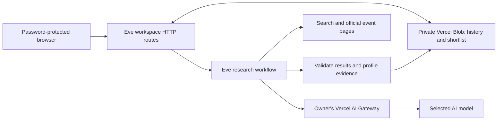

# Pirimid Event Research

A private, AISC-branded workspace for finding industrial events in the United States and Canada and researching their speakers. Built for Dan Rahill, Pirimid.

- Discover relevant events, or paste an event/speaker-page URL.
- Review name, company, role, speaking topic, fit, source evidence and corroborated LinkedIn profile.
- Edit outreach drafts, save prospects and export CSV.
- Password-protected site and API. No automatic outreach.

**Live site:** https://pirimid-event-research.vercel.app

**Start here: [Dan's ownership and setup guide](docs/OWNER_GUIDE.md).**

## Delivery status

The deployed workspace includes saved, reviewed research from three October 15, 2026 live tests. New paid research is disabled until the owner configures API credentials and spending. Existing results, shortlist, draft editing and export work independently of model credentials. Fictional demo mode is separately labeled.

The original live tests used $0.13999091 in total. The temporary test key was revoked. This is historical test cost, not a price guarantee. No Apify account or API is currently required or integrated.

## Run locally

Requires Node.js 24 and npm.

```sh
npm ci
npm run preview
```

Open http://127.0.0.1:4317. This starts the local UI/server with file storage and research off. Use **Try demo** without credentials. See the guide to run the local agent or deploy under your own Vercel account.

## Architecture



Vercel runs the application and durable Eve workflow. Private Blob stores one small workspace document, updated using ETag conditional writes to prevent lost updates. All UI files are embedded at build time and served through password checks. The app never serves raw traces or credentials.

## Code map

| Path | Purpose |
| --- | --- |
| `ui/` | Plain HTML, CSS, JavaScript, fonts and fictional demo |
| `agent/instructions.md` | ICP research rules, source standards, outreach instructions |
| `agent/agent.ts` | Model and per-session limits |
| `agent/channels/home.ts` | Vercel app routes |
| `agent/channels/eve.ts` | Separate research-service authentication |
| `lib/cloud-app.mjs` | Hosted application, request validation, job orchestration |
| `lib/cloud-store.mjs` | Private Blob storage with concurrent-write protection |
| `lib/research.mjs` | Agent client and structured-result validation |
| `lib/schema.mjs` | Event, speaker and prospect fields |
| `preview-server.mjs` | Local preview server with local file storage |
| `samples/` | Reviewed historical results, no raw traces |
| `docs/OWNER_GUIDE.md` | Account, API, deployment and maintenance instructions |

## Validation

```sh
npm test
npm run typecheck
npm run build
```

Tests use fixtures and do not call paid model APIs. `tests/browser-flow.cjs` additionally exercises the local browser journey with Playwright; set `PLAYWRIGHT_MODULE` and `CHROME_PATH` for your machine. `scripts/live-test.mjs` calls a configured live agent and can incur charges; it is not part of `npm test`.

## Scope and limitations

One shared password and one shared workspace. No per-user roles, automatic messaging, CRM integration or recurring event discovery. Some event sites block automated reading; missing LinkedIn profiles stay blank. Research is bounded to small runs, not an exhaustive speaker directory download. Outreach claims remain bracketed until approved company wording is supplied.

The Vercel adapter has fixture coverage and deployed access/persistence checks. Earlier paid live tests used the local adapter. Fresh paid model execution on Vercel must be checked after the owner's API activation. Blob is appropriate for this small workspace; move to a database for large history or many concurrent users. Export important records and back up the private workspace JSON before major changes.

Dependency audit currently flags a moderate `sprintf-js` precision denial-of-service issue through the framework/just-bash dependency chain. Shell tools are not exposed. Do not force-downgrade the framework to satisfy npm's suggested fix; review an upstream compatible patch.
