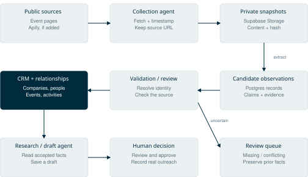
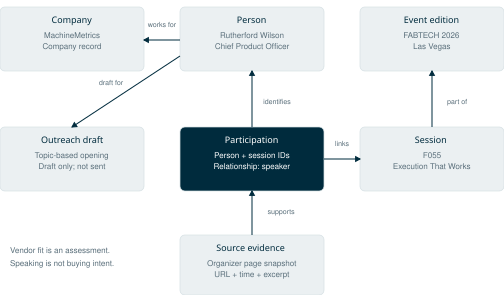

# Pirimid AI Native Event Research Platform
## Ownership and setup guide

Prepared for Dan Rahill · October 15, 2026

### What is included

A private web application that finds relevant industrial events across the United States and Canada, or researches speakers from an event URL. Results include name, company, role, topic, why the person may be relevant, source links, LinkedIn matches where corroborated, and an editable outreach draft. Prospects can be saved and exported.

The repository contains the complete source. The delivered site includes saved results from live tests. Fresh research requires your own credentials and an approved budget. Nothing sends messages to prospects.

### Recommended setup

Use your own **GitHub account, Vercel project, private Vercel Blob store and Vercel AI Gateway key**. This is the shortest path because the application already uses these services. Apify is an optional future scraping integration, not a dependency needed to start.

| Service | Purpose | Required? |
| --- | --- | --- |
| GitHub | Own the code and track changes | Yes |
| Vercel | Host the password-protected application and Eve workflow | Yes for this deployment path |
| Vercel Blob, private | Store research history, saved prospects and edited drafts | Yes on Vercel |
| Vercel AI Gateway | Access the model and built-in web search | Yes for fresh research |
| OpenAI, Anthropic or another model account | Optional provider-specific billing through Gateway BYOK | No separate key needed with Gateway billing |
| Apify | Optional browser-based collection for difficult public event websites | Not integrated in this release |
| Supabase | Proposed CRM and structured research database; see section 11 | Optional next phase |
| LinkedIn API | None used; profiles are matched from public evidence | No |
| Exa API key | Built-in Gateway search uses Exa by default | No separate key needed in this release |

### 1. Take ownership of the source

Repository: https://github.com/mquebd/pirimid-event-research

The repository is private. Request access using your GitHub username. Once access is granted, either transfer the repository into your organization, or create your own private repository from the source. A transfer keeps the existing history; a separate copy lets both versions evolve independently. Private forks can have upstream permission dependencies, so a standalone repository is preferable for independent ownership.

For a developer making a standalone copy:

```sh
git clone https://github.com/mquebd/pirimid-event-research.git
cd pirimid-event-research
git remote rename origin upstream
# Create an empty private repository in your own GitHub account first.
git remote add origin https://github.com/YOUR-ACCOUNT/pirimid-event-research.git
git push -u origin main
```

Keep the repository private unless you deliberately decide to publish it. API keys, passwords and production data are not part of the source handoff. Third-party dependencies and bundled fonts retain their own licenses.

### 2. Preview the interface without spending

Install Node.js 24, then run:

```sh
npm ci
npm run preview
```

Open http://127.0.0.1:4317 and choose **Try demo**. This uses fictional data without calling any provider. Local preview writes real saved records to `.local/`; Vercel uses private Blob instead. Do not expose the local preview port to the internet.

### 3. Create your Vercel project

Create a Vercel account or team owned by Pirimid. Review the current plan and usage pricing before accepting charges. Import your GitHub repository into a new Vercel project.

Use these settings:

| Setting | Value |
| --- | --- |
| Framework | Other |
| Node.js | 24.x |
| Install command | `npm ci` |
| Build command | `npm run build` |
| Output directory | Leave unset; Eve generates Vercel Build Output |
| Production branch | `main` |

Do not enable research during setup. An initial deployment without an application password intentionally returns a configuration error.

CLI alternative, from the repository root:

```sh
npm exec eve link -- --project YOUR-PROJECT --team YOUR-TEAM --non-interactive
```

The shipped `vercel.json` defines the build. The Eve framework deploys its own Vercel workflow and HTTP runtime, so there is no separate server to rent or keep running.

### 4. Add private storage

In the Vercel project, create and connect a **private** Blob store to Production. Give Preview a separate store if preview deployments need persistent data. Do not let development or preview experiments write to the production store.

CLI alternative after linking:

```sh
vercel blob create-store pirimid-workspace --access private --yes --environment production
```

The integration supplies `BLOB_STORE_ID`; current Vercel deployments authenticate to the connected store using project credentials. Older integrations may supply `BLOB_READ_WRITE_TOKEN` instead. Both are supported by the Blob SDK. Do not put either credential in the frontend.

The application creates `pirimid/workspace.json` on its first save. It holds history and saved prospects together. Conditional writes retry concurrent changes rather than overwrite another save. An empty account starts with no research history; fictional demo mode remains available.

### 5. Configure the password and application settings

In Vercel Project Settings → Environment Variables, add the following to **Production**. Use a password manager to generate and retain passwords. Do not paste secrets into a GitHub issue, chat, source file or support screenshot.

| Variable | Value / purpose |
| --- | --- |
| `APP_USERNAME` | `dan`, or your chosen workspace username |
| `APP_PASSWORD` | Random password of at least 20 characters; used in the browser login prompt |
| `EVE_SERVICE_PASSWORD` | A different random password of at least 20 characters; internal research-service access |
| `APP_RESEARCH_ENABLED` | `false` during setup; change to `true` after API and budget setup |
| `APP_DAILY_RUN_LIMIT` | `3` initially; counts started runs, including failed runs |
| `RESEARCH_MODEL` | Optional; defaults to `openai/gpt-6-luna-fast` |
| `AI_GATEWAY_API_KEY` | Your own Gateway key, configured in the next step |
| `BLOB_STORE_ID` | Supplied by the connected private Blob integration |

The deployed app uses a shared browser HTTP Basic login over HTTPS. Anyone with that password can see and edit the shared workspace. Rotate it when access changes. The separate service password is never given to normal users.

### 6. Set up AI and search access

Open **AI Gateway** in your Vercel account. Set up billing or available credits, then create a dedicated key for this application. Use provider-side spending controls, a modest budget and alerts before enabling the app. Add the key to the project's `AI_GATEWAY_API_KEY` environment variable.

The default model is configured in `agent/agent.ts`. The `RESEARCH_MODEL` variable can select another Gateway model ID. Confirm that the selected model supports tools and structured output, then re-test extraction quality. Changing model vendors is not a promise of equivalent research quality.

The built-in search tool uses Gateway search, with Exa as its default provider. The page-reading tool collects public pages. A separate OpenAI key, Exa account, Apify account or LinkedIn subscription is not required for the default configuration.

To use your own model-provider key through Gateway, follow Vercel's BYOK setup in the Gateway dashboard. Keep the application using the Gateway key. Provider model charges, search charges, Vercel workflow/compute and storage are separate cost categories; a model budget is not a complete hosting budget.

The three original live tests cost about $0.14 combined. That figure is an observed test result, not a per-run price or monthly estimate. The app limits concurrency and daily run count; the framework's $1 model-token threshold is soft, can overshoot and excludes search fees. It is not a hard monthly spending cap.

### 7. Deploy and activate

Redeploy after adding environment variables. From the repository root:

```sh
npm test
npm run typecheck
npm run build
npm exec eve deploy -- --project YOUR-PROJECT --team YOUR-TEAM --non-interactive --yes
```

On your new HTTPS URL:

1. Open a private browser window. Confirm it asks for the workspace login.
2. Sign in and run **Try demo**. Confirm the table, details and fictional shortlist work.
3. Confirm real history is empty on a new store. Demo data must stay separate.
4. After configuring your budget, set `APP_RESEARCH_ENABLED=true` and redeploy.
5. Paste a public official event or speaker-directory URL under **Research a link**.
6. Compare a few results with the organizer's agenda. Check the person/company match before using a LinkedIn profile.
7. Edit a message, save it, refresh, and export CSV. Check it remains after a redeployment.
8. Run one discovery for the United States and Canada. Confirm dates and geography fit.

If a site blocks reading, try its official agenda/session page. Results may be partial. The application does not guarantee access to every event website or an exhaustive speaker list.

### 8. Apify: when and how to add it

Apify can help when a public event directory relies on JavaScript that ordinary page reading cannot retrieve. **There is no Apify integration or Apify environment variable consumed by this release. Adding an Apify key alone will not change the app.** Start with the existing search/page-reading flow; add this only for a demonstrated gap.

A developer can implement the optional adapter as follows:

1. Create a Pirimid-owned Apify account and review its usage limits and pricing.
2. Select the official **Website Content Crawler** actor and save a task for public event pages. Test it in Apify's console on an appropriate event page. Start with a small page limit and shallow crawl depth.
3. Create an Apify API token. Store it in Vercel as `APIFY_API_TOKEN`; store the saved task ID as `APIFY_TASK_ID`. These names become active only after adding the adapter below.
4. Add an Eve tool at `agent/tools/apify_read.ts` using `defineTool` from `eve/tools`. Accept a validated public HTTPS event URL, not arbitrary actor code or credentials. Keep task ID and token server-side.
5. Start the saved task using `POST https://api.apify.com/v2/actor-tasks/{taskId}/runs`, with the token in the Authorization header. Supply bounded page/depth settings and a runtime limit. Confirm the actor's current input schema before implementing the payload.
6. Poll that specific run. On success, read its `defaultDatasetId` through `GET /v2/datasets/{datasetId}/items`. Return only the page URL and bounded text fields to the agent. Abort a timed-out run so it does not keep billing.
7. Add a short instruction to use this tool only as a fallback on public event pages. Never give the agent the API token, browser cookies or access to a personal LinkedIn session.
8. Add fixture tests for disabled configuration, bad URLs, failed runs, timeouts, successful extraction and spending controls. Then conduct a small owner-approved live test before relying on it.

Apify supplies page content; the existing AI model still identifies speakers, evaluates fit and drafts outreach. Check Apify's own billing separately. Use public event data and permitted access; this is not a LinkedIn account automation or messaging system.

### 9. Make it your own

| Change | Where to edit |
| --- | --- |
| Brand, logo, layout and labels | `ui/index.html`, `ui/style.css` |
| Default ICP criteria and geography choices | `ui/index.html` and `lib/schema.mjs` |
| Research method, buying roles and source requirements | `agent/instructions.md` |
| Model or session limits | `agent/agent.ts` |
| Table, profile links, shortlist and outreach editing | `ui/app.js` |
| Default outreach wording | `outreach()` in `ui/app.js` and agent instructions |
| Structured output fields | `lib/schema.mjs`, then corresponding UI fields |
| Additional data providers | `agent/tools/` |

Replace bracketed product outcomes, mechanisms and pilot references with approved Pirimid language. Do not invent customers or results. Keep source links even if you simplify the interface further.

Make changes on a GitHub branch, run the tests, review the diff, then merge. If Git integration is connected, merging to `main` triggers production deployment. A working local preview does not prove the deployed API, storage or provider credentials work.

### 10. Data, backup and access

The GitHub repository holds source and reviewed historical sample results. The private Blob store holds live workspace records. Vercel Workflow maintains research-session execution state. These are separate: copying GitHub does not copy live saved prospects or account settings.

Use CSV export for routine prospect backups. Before a major change, download `pirimid/workspace.json` from the private Blob dashboard to a secure backup location. Do not commit the file to GitHub. Restore only after backing up the current file and pausing new research. A larger team should replace the single-document store with a database and individual user logins.

A Vercel rollback changes code, not stored data. Export and back up before schema changes. Rotate the application password, service password and provider keys during an ownership transfer; verify the new account and storage connection before disabling the old workspace.

### Troubleshooting

| Symptom | Check |
| --- | --- |
| Login repeatedly rejected | `APP_USERNAME`, `APP_PASSWORD`, correct deployment and browser's cached credentials |
| Configuration error before login | Production password is missing or shorter than 20 characters |
| API setup required | `APP_RESEARCH_ENABLED` remains false; finish credentials and budget setup |
| Research fails | Gateway billing/key/model availability, Vercel logs and service password |
| Save or history fails | Private Blob store connection and its Production environment variables |
| No LinkedIn link | No sufficiently corroborated match; use the supplied LinkedIn search and verify manually |
| Event page has few results | Organizer page unavailable, blocked, incomplete, or wrong edition |
| Research marked interrupted | Run exceeded the app timeout or execution stopped; review provider usage before retrying |
| Preview cannot save | Preview needs its own storage connection and password variables |

### 11. Add Supabase as the CRM and research foundation

**Proposed next phase. Supabase is not connected to the deployed application.** This section is the implementation plan for expanding it. Creating a Supabase account or adding keys alone does not install a CRM.

The recommendation is to use one Pirimid-owned Supabase project for both CRM records and structured research, with a private Storage bucket for captured source files. Keep the AISC application as the working interface. Supabase is the underlying database and API platform; the contact, pipeline, activity and research screens still need to be built.

An **ontology** is the shared definition of the things the system knows about and how they relate. For this app: a person works for a company, speaks in a session, and that session belongs to a particular event edition. A source snapshot supports a statement about one of those relationships. An outreach draft refers back to the person and evidence. The same person can appear at many events without becoming many separate contacts.

Use ordinary Postgres tables, stable IDs and foreign keys to implement that model first. A separate graph database is unnecessary for this initial scope. Search embeddings can be added later for finding related topics; they do not replace entity identity, source evidence or relationships.

#### Proposed data flow



A scrape creates a source snapshot and candidate observations first. Validation resolves identities and checks evidence before updating CRM records. Missing or conflicting information goes to review rather than silently replacing an approved record. The outreach agent reads accepted facts, writes a draft, and leaves sending to a person.

#### The initial ontology

| Record | Meaning and useful fields |
| --- | --- |
| Companies | One organization: stable ID, canonical name, normalized domain, industry and buyer/partner/vendor classification. A domain helps match companies but subsidiaries may need separate IDs. |
| People and employment | One person plus dated employment relationships: person ID, company ID, role, valid-from/to dates and verified LinkedIn URL when available. Never merge two people on name alone. |
| Events and editions | An event brand plus each dated edition: series ID, edition ID, country, city, start/end dates and organizer URL. Keep FABTECH 2026 distinct from FABTECH 2027. |
| Sessions and participation | Session title/topic linked to an event edition; join records link people to sessions as speakers. Exhibitor and attendee relationships are separate evidence-backed records. |
| Sites and projects | Optional industrial facilities, turnarounds and construction projects linked to owner and contractor companies. A company can own several sites; a project can involve several contractors. |
| Opportunities and activities | CRM pipeline records: target company/site, owner, stage, next action, due date, notes and human-recorded contact history. Speaking at an event does not create a qualified opportunity automatically. |
| Sources and snapshots | Canonical source URL, retrieved timestamp, content hash, private storage path, extraction method, fetch status and captured content. Preserve versions rather than overwriting yesterday's page. |
| Observations and evidence | A candidate statement about a person, company, session or relationship; link to the snapshot and supporting excerpt, observation time, confidence, review status and superseded record. |
| Research runs and assessments | Input query, provider/model, timestamps, status, provenance and fit assessment. Keep AI-generated relevance judgments separate from observed facts. |
| Outreach drafts and audit events | Person/session/opportunity links, draft text, approval state and the actor/run responsible for each change. A draft is not a sent message. |

Every record belongs to a workspace. Use uniqueness rules for reliable identities, and indexes on workspace IDs, foreign keys, source hashes and frequently searched dates. Use typed join tables such as employment and session participation, rather than a free-form relationship table that permits impossible links.

#### Example: one speaker, several connected records



This example uses the reviewed FABTECH sample already included with the app: Rutherford Wilson, MachineMetrics, and session F055. It illustrates the proposed data model, not records already created in Supabase. The organizer evidence supports a speaker/session association and the listed company/role. It does not establish purchase intent. The vendor label is an assessment and should remain distinct from the observed speaker relationship.

A practical agent request would be: “Find upcoming speakers at industrial events whose companies fit our target market, show the evidence, exclude people contacted in the last 30 days, and draft a topic-specific opening.” The database joins people, current employment, session participation, event editions, fit assessments and recorded activities. If contact history has not been recorded or imported, the answer must say that rather than assume nobody has been contacted.

#### Setup and migration sequence

1. Create a Supabase project owned by Pirimid. Select a suitable region and review plan, storage, backup and usage costs before provisioning paid resources. Use a separate development project for schema work.
2. Implement the table model above as versioned migrations in GitHub. Start with companies, people, employment, event editions, sessions, participation, source snapshots, observations, research runs, activities and outreach drafts. Add sites/projects as those prospecting workflows are introduced.
3. Create a **private** Storage bucket, for example `research-sources`, for permitted HTML/text/PDF snapshots. Store metadata and content hashes in Postgres, not large page bodies in every CRM row. Define retention and deletion rules for snapshots and personal contact data.
4. Replace the single shared password with Supabase Auth when individual users or agent identities are needed. Create workspace membership records and role-specific Row Level Security policies. Configure explicit grants as well as RLS on exposed tables, and protect Storage objects with matching access rules. A browser publishable key is safe only with the intended access policies; secret/service-role keys bypass RLS and must never reach the browser or a model prompt. See the official Supabase security references below.
5. Configure server-side `SUPABASE_URL` and the appropriate server credential in Vercel. If adding browser Auth, use the project URL and publishable key for the browser. These variables are proposed names for the future adapter; the current app does not consume them. Pin the SDK version and keep secrets out of GitHub.
6. Implement a storage adapter and CRM endpoints alongside `lib/cloud-store.mjs`. Export the existing Blob workspace, map each record into the new entities, preserve original IDs and source links, and deduplicate with a review step. Test in development, compare imported counts and a sample of relationships, then switch the app to Supabase. Keep Blob as a read-only rollback snapshot until the new system is verified; do not maintain two competing writable CRMs.
7. Add agent tools for specific jobs: `find_contacts`, `record_source_snapshot`, `propose_observation`, `save_outreach_draft` and `record_activity`. Validate inputs and derive workspace access from verified credentials. Give research workers narrowly scoped write permissions; do not give an autonomous prospecting agent unrestricted SQL, database administration or a project-wide service key.
8. Test denied access as well as allowed access: anonymous requests, another workspace's records, a worker trying to change pipeline stage, duplicate scrapes, a changed speaker role and failed provider runs. Re-running the same source snapshot must not duplicate contacts or activities. Confirm data persists across deployments and that the backup restores correctly before switching production.

Supabase's development MCP connection can help a coding assistant inspect a scoped development project and build migrations. It is separate from the production research agent's tools. Begin with read-only development access where possible; production agents should call the narrow application tools above. Adding MCP does not automatically provide a safe CRM integration.

#### Agent responsibilities and record rules

| Agent/tool role | Permitted work |
| --- | --- |
| Discovery | Read accepted CRM facts and public sources; propose events and target companies. |
| Collection | Capture bounded source content and metadata; append source snapshots and ingestion status. |
| Extraction | Propose observations and identity matches with evidence; do not silently merge uncertain people. |
| CRM research | Read relevant entities and activities; save fit assessments and next-action suggestions. |
| Outreach drafting | Read approved company claims and contact context; save editable drafts. No autonomous sending. |
| Human review | Resolve conflicting identities, approve important field changes, and record actual outreach or opportunity-stage changes. |

Retain three different timestamps: when a source was fetched, when a fact was observed, and when that fact is believed valid. Keep rejected and superseded observations so an agent can explain a correction. Treat scraped text as source material, never as instructions that can alter agent permissions.

Start with this small, typed ontology and expand only when a new workflow needs another entity or relationship. The goal is a CRM the agents can reason over and update reliably, with evidence behind the records.

### Official references

- [Vercel GitHub integration](https://vercel.com/docs/git/vercel-for-github)
- [Vercel environment variables](https://vercel.com/docs/environment-variables)
- [Vercel AI Gateway](https://vercel.com/docs/ai-gateway)
- [AI Gateway bring your own key](https://vercel.com/docs/ai-gateway/authentication-and-byok/byok)
- [Vercel Blob](https://vercel.com/docs/vercel-blob)
- [Vercel usage and pricing](https://vercel.com/pricing)
- [Apify API getting started](https://docs.apify.com/api/v2/getting-started)
- [Apify saved-task API](https://docs.apify.com/api/v2/actor-task-runs-post)
- [Website Content Crawler](https://apify.com/apify/website-content-crawler)
- [Eve framework](https://eve.dev/docs)

- [Supabase tables and relationships](https://supabase.com/docs/guides/database/tables)
- [Supabase Data API security](https://supabase.com/docs/guides/api/securing-your-api)
- [Supabase Row Level Security](https://supabase.com/docs/guides/database/postgres/row-level-security)
- [Supabase Storage access control](https://supabase.com/docs/guides/storage/security/access-control)
- [Supabase development MCP](https://supabase.com/docs/guides/ai-tools/mcp)
